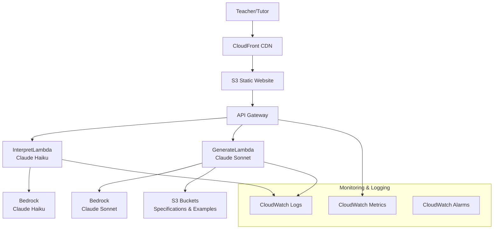

# Design Document: GCSE Question Generator

## Overview

The GCSE Question Generator is a serverless AI-powered platform that enables teachers to generate high-quality GCSE exam questions through natural language requests. The system employs a two-stage AI processing architecture using AWS Bedrock models: Claude Haiku for fast query interpretation and Claude Sonnet for sophisticated question generation. The platform uses deterministic topic-to-file mapping with S3 storage to retrieve relevant Edexcel specifications and proven question patterns, eliminating the need for complex vector databases while maintaining high accuracy and dramatically reducing costs.

The architecture follows AWS Well-Architected Framework principles with emphasis on cost optimization through intelligent model selection and simple storage patterns, operational excellence via Infrastructure as Code, and security through least-privilege access controls.

## Architecture

### High-Level Architecture



### Request Flow

1. **User Query**: Teacher submits natural language request via web interface
2. **Interpretation**: API Gateway routes to InterpretLambda → Claude Haiku parses query into structured intent
3. **Content Retrieval**: GenerateLambda receives structured intent → retrieves relevant specifications and examples from S3 using deterministic topic mapping
4. **Question Generation**: GenerateLambda combines retrieved content with intent → Claude Sonnet generates questions and mark schemes
5. **Response**: Formatted JSON response returned to frontend for display

### Regional Deployment

All resources deployed in **eu-west-2 (London)** region for:
- Data residency compliance
- Optimized latency for UK users  
- Bedrock model availability
- CloudFront uses global edge locations with eu-west-2 origin

## Security Architecture

### IAM Roles and Policies

**InterpretLambda Execution Role**
- Policy: `bedrock:InvokeModel` (scoped to Haiku model ARN only)
- Policy: `logs:CreateLogGroup`, `logs:CreateLogStream`, `logs:PutLogEvents`
- Trust relationship: lambda.amazonaws.com

**GenerateLambda Execution Role**
- Policy: `bedrock:InvokeModel` (scoped to Sonnet model ARN)
- Policy: `s3:GetObject` (scoped to specifications and examples buckets)
- Policy: `logs:*`
- Trust relationship: lambda.amazonaws.com

**CloudFront Origin Access Control**
- S3 bucket policy allows only CloudFront distribution
- Deny all other access

**API Gateway Execution Role**
- Policy: `lambda:InvokeFunction` (scoped to both Lambda functions)

## Components and Interfaces

### Frontend Layer

**S3 Static Website Hosting**
- React/Vue.js single-page application
- Bucket policy restricts access to CloudFront only
- Versioning enabled for rollback capability
- SSE-S3 encryption at rest

**CloudFront Distribution**
- Global CDN with HTTPS-only (TLS 1.2+)
- Custom domain support with ACM certificate
- Caching strategy: static assets cached, API calls not cached
- Origin Access Control (OAC) for S3 security

**User Interface Components**
- Query input form with 500 character limit
- Question display in numbered list format
- Collapsible mark scheme sections
- LaTeX mathematical notation rendering
- Error message display with user guidance

### API Layer

**API Gateway (REST API)**
- Two endpoints: `POST /api/interpret` and `POST /api/generate`
- CORS configuration for frontend domain
- Request validation and input sanitization
- Rate limiting: 100 requests per user per hour
- API key authentication for access control

**Standardized Error Response Format**
```json
{
  "error": {
    "type": "ValidationError|TimeoutError|ServiceUnavailable|InternalError",
    "message": "User-friendly error description",
    "details": "Specific error context for debugging",
    "request_id": "uuid-v4",
    "timestamp": "2024-12-26T10:30:00Z",
    "guidance": "Suggested user action to resolve",
    "retry_after": 60
  }
}
```

**Request/Response Schemas**

```json
// POST /api/interpret
{
  "query": "fractions Foundation 5 questions"
}

// Response
{
  "topic": "Number",
  "subtopic": "Fractions", 
  "tier": "Foundation",
  "count": 5,
  "confidence": 0.95
}

// POST /api/generate  
{
  "topic": "Fractions",
  "tier": "Foundation", 
  "count": 5,
  "specification_version": "latest"
}

// Response (per Requirement 17)
{
  "questions": [
    {
      "id": "q1",
      "question_text": "Calculate 3/4 + 1/8",
      "marks": 2,
      "tier": "Foundation",
      "topic": "Fractions"
    }
  ],
  "mark_scheme": [
    {
      "question_id": "q1", 
      "marking_criteria": "Method: Convert to common denominator (1 mark), Accuracy: Correct answer 7/8 (1 mark)",
      "method_marks": 1,
      "accuracy_marks": 1
    }
  ],
  "metadata": {
    "generated_at": "2024-12-26T10:30:00Z",
    "model_version": "claude-3-sonnet-20240229",
    "total_marks": 2,
    "specification_version": "2024.1"
  }
}
```

### Lambda Functions

**InterpretLambda Configuration**
- Runtime: Python 3.11
- Memory: 512 MB
- Timeout: 30 seconds
- Environment Variables:
  - `BEDROCK_MODEL_ID`: `anthropic.claude-3-haiku-20240307`
  - `AWS_REGION`: `eu-west-2`

**GenerateLambda Configuration**  
- Runtime: Python 3.11
- Memory: 1024 MB
- Timeout: 60 seconds
- Environment Variables:
  - `BEDROCK_MODEL_ID`: `anthropic.claude-3-sonnet-20240229`
  - `SPECIFICATIONS_BUCKET`: (from Terraform output)
  - `EXAMPLES_BUCKET`: (from Terraform output)
  - `AWS_REGION`: `eu-west-2`

**Error Handling Strategy**
- Exponential backoff retry (3 attempts) for Bedrock API failures
- Circuit breaker pattern for S3 unavailability
- Structured error responses with request IDs
- CloudWatch logging for all errors with context

### AI Processing Layer

**Claude Haiku (Interpretation)**
- Fast, cost-effective query parsing
- Structured prompt engineering for intent extraction
- Confidence scoring for ambiguous queries
- Fallback to error messages for unparseable input

```python
def calculate_confidence(intent: QueryIntent, query: str) -> float:
    """Calculate confidence score for parsed intent (0.0-1.0)"""
    confidence = 1.0
    
    if intent.topic not in KNOWN_TOPICS:
        confidence -= 0.3
    if "foundation" not in query.lower() and "higher" not in query.lower():
        confidence -= 0.2
    if not re.search(r'\d+', query):
        confidence -= 0.2
        
    return max(0.0, confidence)
```

**Claude Sonnet (Generation)**
- High-quality question and mark scheme generation
- Context-aware prompting with specifications and examples
- Quality validation of generated content
- Mathematical notation in LaTeX format

```python
def validate_question_quality(question: Question, mark_scheme: MarkScheme) -> ValidationResult:
    """Validates generated question meets quality standards"""
    errors = []
    confidence = 1.0
    
    # Check mathematical elements present
    required_elements = get_required_elements(question.topic)
    if not all(elem in question.question_text for elem in required_elements):
        errors.append("Missing required mathematical elements")
        confidence -= 0.3
    
    # Check mark scheme alignment
    if mark_scheme.total_marks != question.marks:
        errors.append("Mark scheme total doesn't match question marks")
        confidence -= 0.4
    
    # Check tier-appropriate difficulty
    difficulty_score = assess_difficulty(question.question_text)
    if question.tier == "Foundation" and difficulty_score > 0.7:
        errors.append("Question too difficult for Foundation tier")
        confidence -= 0.3
    
    return ValidationResult(
        is_valid=len(errors) == 0,
        confidence=max(0.0, confidence),
        errors=errors
    )
```

**Bedrock Integration Patterns**
```python
# Converse API usage for consistent interface
response = bedrock_client.converse(
    modelId=model_id,
    messages=[{"role": "user", "content": [{"text": prompt}]}],
    inferenceConfig={
        "maxTokens": 4000,
        "temperature": 0.1,
        "topP": 0.9
    }
)
```

### Content Retrieval Layer

**S3-Based Topic Mapping**
- Deterministic topic-to-file mapping eliminates vector search complexity
- Organized specification content by domain and subtopic
- Fast, reliable retrieval with predictable costs
- No embedding generation or similarity calculations required

**Topic Mapping Strategy**
```python
TOPIC_MAPPING = {
    "fractions": {"domain": "number", "file": "fractions.json"},
    "algebra": {"domain": "algebra", "file": "linear-equations.json"},
    "geometry": {"domain": "geometry", "file": "angles.json"},
    "statistics": {"domain": "statistics", "file": "data-analysis.json"}
}

def get_specification_content(topic: str) -> dict:
    """Retrieve specification content from S3 based on topic"""
    mapping = TOPIC_MAPPING.get(topic.lower())
    if not mapping:
        raise ValueError(f"Unknown topic: {topic}")
    
    key = f"specifications/{mapping['domain']}/{mapping['file']}"
    response = s3.get_object(Bucket='specifications-bucket', Key=key)
    return json.loads(response['Body'].read())

def get_examples_content(topic: str) -> dict:
    """Retrieve seed examples from S3 based on topic"""
    mapping = TOPIC_MAPPING.get(topic.lower())
    if not mapping:
        return []
    
    key = f"examples/{mapping['domain']}/{mapping['file']}"
    response = s3.get_object(Bucket='examples-bucket', Key=key)
    return json.loads(response['Body'].read())
```

**Multi-Domain Paper Generation**
```python
def generate_multi_domain_paper(topics: List[TopicRequest]) -> QuestionSet:
    """Generate paper spanning multiple domains"""
    all_content = []
    
    for topic in topics:
        # Retrieve specification and examples from S3
        spec = get_specification_content(topic.subtopic)
        examples = get_examples_content(topic.subtopic)
        
        all_content.append({
            'topic': topic.subtopic,
            'tier': topic.tier,
            'count': topic.count,
            'specification': spec,
            'examples': examples
        })
    
    # Single Bedrock call with all content
    prompt = construct_multi_topic_prompt(all_content)
    response = bedrock.converse(modelId='claude-sonnet', messages=[prompt])
    
    return parse_response(response)
```

**Content Structure**
```json
{
  "domain": "number",
  "subtopic": "fractions",
  "tier": "foundation",
  "learning_objectives": [
    "Add and subtract fractions with same denominator",
    "Convert between mixed numbers and improper fractions"
  ],
  "specification_content": "Students should be able to...",
  "key_concepts": ["numerator", "denominator", "equivalent fractions"],
  "common_misconceptions": ["Adding denominators", "Confusion with mixed numbers"]
}
```

### Storage Layer

**S3 Bucket Architecture**
- `frontend-assets-bucket`: Static website files
- `specifications-bucket`: Edexcel specifications organized by topic
  - Structure: `specifications/{domain}/{subtopic}.json`
  - Example: `specifications/number/fractions.json`
- `examples-bucket`: Verified question examples
  - Structure: `examples/{domain}/{subtopic}.json`
- All buckets: versioning enabled, SSE-S3 encryption

**Content Management Process**
1. Specification updates trigger re-parsing pipeline
2. Content organized by domain and subtopic structure
3. JSON files stored with metadata and learning objectives
4. Previous versions retained for 90 days
5. No embedding generation required - direct file retrieval

## Cost Analysis and Optimization

### Estimated Monthly Costs (100 users, 50 requests/user/month)

**Bedrock Costs:**
- Claude Haiku (interpretation): 5,000 requests × $0.00025 = $1.25
- Claude Sonnet (generation): 5,000 requests × $0.003 = $15.00
- **Total Bedrock: ~$16.25/month**

**S3:**
- Storage: <$1/month (specifications + examples)
- GET requests: 5,000 × $0.0004/1000 = $0.002
- **Total S3: <$1/month**

**Lambda:**
- Within free tier for expected usage
- **Total Lambda: $0/month**

**CloudFront:**
- Within free tier for expected usage
- **Total CloudFront: $0/month**

**API Gateway:**
- Within free tier for expected usage
- **Total API Gateway: $0/month**

**Total Estimated Cost: ~$18/month (£14/month)**

### Cost Optimization Achievements

- **93% cost reduction** vs original OpenSearch design (£376 → £14)
- **Linear scaling** with usage (no fixed infrastructure costs)
- **Predictable costs** - no surprise OCU charges
- **Aligns with proven patterns** - matches other successful projects ($3-5/month for 30 users)

### Cost Optimization Strategies

1. Cache frequent queries to reduce Bedrock calls
2. Organize content efficiently in S3 for fast retrieval
3. Use CloudFront caching aggressively for static assets
4. Implement request throttling at £20/day threshold (updated from £50)
5. No fixed infrastructure costs - pure pay-per-use model

## Caching Architecture

### Multi-Layer Caching Strategy

**CloudFront Caching (Layer 1):**
- Static assets: 1 year TTL
- API responses: No caching (dynamic content)

**Lambda In-Memory Caching (Layer 2):**
```python
# Global cache (persists across warm Lambda invocations)
QUERY_CACHE = {}
CACHE_TTL = 3600  # 1 hour

def get_cached_response(query_hash):
    if query_hash in QUERY_CACHE:
        cached_item = QUERY_CACHE[query_hash]
        if time.time() - cached_item['timestamp'] < CACHE_TTL:
            return cached_item['response']
    return None
```

**DynamoDB Caching (Layer 3 - Optional for Production):**
- Cache frequent query patterns
- TTL: 24 hours
- Reduces Bedrock costs for common requests
- Schema: {query_hash: string, response: json, ttl: number}

### Cache Invalidation
- Specification updates trigger cache clear
- Manual invalidation via admin API
- Automatic TTL expiration

## Content Processing Pipeline

### Specification Parsing and Organization

**Step 1: PDF Parsing**
```python
import pdfplumber

def parse_edexcel_pdf(pdf_path):
    """Extract structured content from Edexcel specification PDF."""
    with pdfplumber.open(pdf_path) as pdf:
        sections = []
        for page in pdf.pages:
            text = page.extract_text()
            parsed = parse_section_structure(text)
            sections.extend(parsed)
    return sections
```

**Step 2: Content Organization**
- Organize content by domain and subtopic
- Create JSON files for each topic area
- Include learning objectives and key concepts
- No chunking or embedding generation required

**Step 3: S3 Storage**
```python
def store_specification_content(domain, subtopic, content):
    """Store organized content in S3."""
    key = f"specifications/{domain}/{subtopic}.json"
    s3.put_object(
        Bucket='specifications-bucket',
        Key=key,
        Body=json.dumps(content),
        ContentType='application/json'
    )
```

**Processing Time Estimates:**
- PDF parsing: ~5 minutes
- Content organization: ~10 minutes
- S3 upload: ~1 minute
- Total: ~16 minutes one-time setup (vs 45 minutes with embeddings)

## Monitoring and Alerting

### CloudWatch Dashboard Widgets

**API Gateway Metrics:**
- Request count (per endpoint)
- 4xx/5xx error rates
- Latency (p50, p95, p99)
- Integration latency

**Lambda Metrics:**
- Invocation count
- Error count and rate
- Duration (p50, p95, p99)
- Concurrent executions
- Throttles

**Bedrock Metrics:**
- Token usage (input/output)
- Model invocation count
- Latency per model
- Error rate

**S3 Metrics:**
- GET request count
- Request latency
- Error rate
- Storage utilization

**Cost Metrics:**
- Daily Bedrock spend
- Monthly S3 spend
- Total daily cost

### CloudWatch Alarms

**Critical Alarms (PagerDuty/SNS):**
- Lambda error rate > 5% (5-minute period)
- API Gateway 5xx rate > 1% (5-minute period)
- S3 unavailable (1-minute period)
- Daily cost > £20

**Warning Alarms (Email):**
- Lambda duration > 50 seconds (approaching timeout)
- API Gateway latency > 10 seconds
- Bedrock throttling detected
- Monthly cost > £40 (80% of threshold)

## Infrastructure as Code Structure

### Terraform Module Organization

```
terraform/
├── main.tf                 # Root module, provider config
├── variables.tf            # Input variables
├── outputs.tf              # Output values
├── backend.tf              # Remote state configuration
├── modules/
│   ├── frontend/
│   │   ├── main.tf         # S3 + CloudFront
│   │   ├── variables.tf
│   │   ├── outputs.tf
│   │   └── iam.tf          # OAC policies
│   ├── api/
│   │   ├── main.tf         # API Gateway
│   │   ├── lambda.tf       # Both Lambda functions
│   │   ├── iam.tf          # Lambda execution roles
│   │   ├── variables.tf
│   │   └── outputs.tf
│   ├── ai/
│   │   ├── main.tf         # Bedrock model configurations
│   │   ├── iam.tf          # Bedrock access policies
│   │   └── outputs.tf
│   ├── knowledge/
│   │   ├── s3.tf           # Specification/examples buckets
│   │   ├── iam.tf          # S3 access policies
│   │   └── outputs.tf
│   └── monitoring/
│       ├── cloudwatch.tf   # Logs, metrics, dashboards
│       ├── alarms.tf       # CloudWatch alarms
│       ├── sns.tf          # SNS topics for alerts
│       └── outputs.tf
└── environments/
    ├── dev.tfvars
    └── prod.tfvars
```

**Key Terraform Resources:**
- `aws_s3_bucket` (frontend, specifications, examples)
- `aws_cloudfront_distribution`
- `aws_api_gateway_rest_api`
- `aws_lambda_function` (InterpretLambda, GenerateLambda)
- `aws_iam_role` (Lambda execution roles)
- `aws_iam_policy` (least-privilege policies)
- `aws_cloudwatch_log_group`
- `aws_cloudwatch_metric_alarm`
- `aws_sns_topic` (alerting)

## Deployment Strategy

### Deployment Pipeline

**Development Workflow:**
1. Feature branch → Pull request → Code review
2. Automated tests run on PR (unit + integration)
3. Terraform plan preview in PR comments
4. Merge to main → Deploy to dev environment
5. Manual approval → Deploy to production

**Terraform Deployment Process:**
```bash
# Initialize backend
terraform init -backend-config="bucket=gcse-terraform-state" \
               -backend-config="key=prod/terraform.tfstate" \
               -backend-config="region=eu-west-2" \
               -backend-config="dynamodb_table=terraform-locks"

# Plan changes
terraform plan -var-file="environments/prod.tfvars" -out=tfplan

# Apply changes
terraform apply tfplan
```

**Lambda Deployment:**
- Package Python code with dependencies
- Upload to S3 deployment bucket
- Terraform references S3 object for Lambda function code
- Blue/green deployment with alias shifting

**Frontend Deployment:**
- Build React/Vue app: `npm run build`
- Upload to S3: `aws s3 sync dist/ s3://frontend-bucket/`
- Invalidate CloudFront cache: `aws cloudfront create-invalidation`

**Rollback Strategy:**
- Terraform state versioning in S3
- Lambda function versions for instant rollback
- CloudFront cache invalidation for frontend rollback

## Disaster Recovery Plan

### Backup Strategy
- S3 versioning: Automatic, 90-day retention
- Terraform state: Versioned in S3

### Recovery Procedures

**Scenario 1: S3 Bucket Deletion**
- RTO: 1 hour
- Restore from S3 versioning
- Redeploy CloudFront distribution

**Scenario 2: Complete Region Failure**
- RTO: 4 hours
- Deploy to backup region (eu-west-1)
- Update DNS to point to new CloudFront
- Restore data from S3 cross-region replication

## Data Models

### Core Domain Models

**Query Intent**
```python
@dataclass
class QueryIntent:
    topic: str              # "Number", "Algebra", "Geometry"
    subtopic: Optional[str] # "Fractions", "Linear Equations"
    tier: str              # "Foundation" | "Higher"  
    count: int             # 1-50 questions
    marks: Optional[int]   # Total marks requested
    confidence: float      # 0.0-1.0 parsing confidence
    specification_version: str = "latest"
```

**Question Model**
```python
@dataclass  
class Question:
    id: str
    question_text: str
    marks: int
    tier: str
    topic: str
    subtopic: Optional[str]
    mathematical_elements: List[str]
    difficulty_indicators: List[str]
```

**Mark Scheme Model**
```python
@dataclass
class MarkScheme:
    question_id: str
    marking_criteria: str
    method_marks: int
    accuracy_marks: int
    total_marks: int
    common_errors: List[str]
```

**Content Models**
```python
@dataclass
class SpecificationContent:
    content: str
    topic: str
    tier: str
    version: str
    learning_objectives: List[str]

@dataclass  
class SeedExample:
    question: Question
    mark_scheme: MarkScheme
    quality_score: float
    verification_status: str
```

**S3 Content File Structure**

**Specification File Example** (`specifications/number/fractions.json`):
```json
{
  "domain": "number",
  "subtopic": "fractions",
  "tier": "both",
  "version": "2024.1",
  "learning_objectives": [
    "Add and subtract fractions with same denominator",
    "Convert between mixed numbers and improper fractions",
    "Multiply and divide fractions"
  ],
  "specification_content": "Students should be able to work confidently with fractions, including adding, subtracting, multiplying and dividing fractions...",
  "key_concepts": ["numerator", "denominator", "equivalent fractions", "simplification"],
  "common_misconceptions": [
    "Adding denominators when adding fractions",
    "Confusion between mixed numbers and improper fractions"
  ],
  "assessment_objectives": ["AO1", "AO2"],
  "marks_range": [1, 4]
}
```

**Seed Examples File** (`examples/number/fractions.json`):
```json
{
  "domain": "number",
  "subtopic": "fractions",
  "examples": [
    {
      "question": {
        "id": "ex1",
        "question_text": "Calculate 3/4 + 1/8. Show your working.",
        "marks": 2,
        "tier": "Foundation",
        "topic": "Fractions"
      },
      "mark_scheme": {
        "question_id": "ex1",
        "marking_criteria": "M1: Convert to common denominator (6/8 + 1/8), A1: Correct answer 7/8",
        "method_marks": 1,
        "accuracy_marks": 1
      },
      "quality_score": 0.95,
      "verification_status": "verified"
    }
  ]
}
```

## Correctness Properties

*A property is a characteristic or behavior that should hold true across all valid executions of a system—essentially, a formal statement about what the system should do. Properties serve as the bridge between human-readable specifications and machine-verifiable correctness guarantees.*

### Property 1: Query Parsing Completeness
*For any* valid natural language query containing topic, tier, and quantity information, the Interpret_Service should extract all components into a structured intent with the correct topic, tier, and count values.
**Validates: Requirements 1.1, 1.2, 1.3, 1.4**

### Property 2: Error Handling for Invalid Queries  
*For any* ambiguous, incomplete, or malformed query, the System should return a descriptive error message containing error type, user-actionable guidance, and a unique request ID.
**Validates: Requirements 1.5**

### Property 3: Content Retrieval for Generation
*For any* question generation request, the Generate_Service should retrieve relevant specification sections from S3 that match the requested topic and tier using deterministic topic-to-file mapping.
**Validates: Requirements 2.2**

### Property 4: Specification Version Management
*For any* generated question set, the System should tag the output with the specification version used and support multiple versions simultaneously.
**Validates: Requirements 2.6**

### Property 5: Complete Question Generation
*For any* valid generation request, the Generate_Service should produce exactly the requested number of questions, each with a corresponding mark scheme, formatted as valid JSON matching the defined schema.
**Validates: Requirements 4.1, 4.3, 4.5, 17.1**

### Property 5: Content Alignment Validation
*For any* generated question, the content should align with the requested topic and tier, contain appropriate mathematical elements for the topic, and have mark schemes that match the question difficulty level.
**Validates: Requirements 4.2, 18.1, 18.2**

### Property 6: Interpretation Performance
*For any* interpretation request, the System should complete processing within 30 seconds or return a timeout error with descriptive message.
**Validates: Requirements 7.4**

### Property 7: Generation Performance  
*For any* generation request, the System should complete processing within 60 seconds or return a timeout error with descriptive message.
**Validates: Requirements 7.5**

### Property 8: Bedrock API Resilience
*For any* Bedrock API failure, the System should retry up to 3 times with exponential backoff before returning an error.
**Validates: Requirements 16.1**

### Property 9: S3 Storage Fallback
*For any* S3 unavailability scenario, the System should return cached responses when available or a descriptive error message when caching is not possible.
**Validates: Requirements 16.2**

## Error Handling

### Error Classification and Response Strategy

**Client Errors (4xx)**
- 400 Bad Request: Malformed JSON, invalid parameters, query too long (>500 chars)
- 401 Unauthorized: Missing or invalid API key
- 429 Too Many Requests: Rate limit exceeded (>100 requests/hour)

**Server Errors (5xx)**  
- 500 Internal Server Error: Unexpected Lambda failures, unhandled exceptions
- 503 Service Unavailable: Bedrock API unavailable, S3 unavailable
- 504 Gateway Timeout: Lambda timeout exceeded (30s interpret, 60s generate)

### Error Response Format
```json
{
  "error": {
    "type": "ValidationError|TimeoutError|ServiceUnavailable",
    "message": "User-friendly error description",
    "details": "Specific technical details for debugging",
    "request_id": "uuid-for-tracking",
    "guidance": "Suggested user actions",
    "timestamp": "2024-12-26T10:30:00Z"
  }
}
```

### Resilience Patterns

**Circuit Breaker Pattern**
```python
class CircuitBreaker:
    def __init__(self, failure_threshold=3, timeout=60):
        self.failure_count = 0
        self.failure_threshold = failure_threshold
        self.timeout = timeout
        self.last_failure_time = None
        self.state = "CLOSED"  # CLOSED, OPEN, HALF_OPEN
    
    def call(self, func):
        if self.state == "OPEN":
            if time.time() - self.last_failure_time > self.timeout:
                self.state = "HALF_OPEN"
            else:
                raise CircuitBreakerOpenError("S3 unavailable")
        
        try:
            result = func()
            if self.state == "HALF_OPEN":
                self.state = "CLOSED"
                self.failure_count = 0
            return result
        except Exception as e:
            self.failure_count += 1
            self.last_failure_time = time.time()
            if self.failure_count >= self.failure_threshold:
                self.state = "OPEN"
            raise
```

**Retry Strategy**
- Bedrock API: Exponential backoff (1s, 2s, 4s) with jitter
- S3: Linear backoff (1s, 2s, 3s) for transient failures
- Maximum 3 retry attempts before failure

**Graceful Degradation**
- S3 unavailable → Use cached specification content
- Bedrock unavailable → Return service unavailable with retry guidance
- Partial results → Return available questions with warning

### Input Validation and Sanitization

**Query Validation**
- Length: 1-500 characters
- Content: Alphanumeric, spaces, basic punctuation only
- SQL injection pattern detection and rejection
- XSS prevention through input encoding

**Request Validation**
- JSON schema validation for all API requests
- Parameter range validation (count: 1-50, tier: Foundation|Higher)
- Required field presence validation

## Testing Strategy

### Dual Testing Approach

The system employs both unit testing and property-based testing as complementary approaches:

**Unit Tests** focus on:
- Specific examples and edge cases
- Integration points between components  
- Error conditions and boundary values
- Concrete scenarios with known inputs/outputs

**Property-Based Tests** focus on:
- Universal properties across all valid inputs
- Comprehensive input coverage through randomization
- Correctness properties defined in this design document
- Invariants that must hold regardless of specific inputs

### Property-Based Testing Configuration

**Framework**: Hypothesis (Python) for property-based testing
**Test Configuration**:
- Minimum 100 iterations per property test
- Each test tagged with: **Feature: gcse-question-generator, Property {number}: {property_text}**
- Custom generators for domain-specific data (queries, topics, tiers)

**Property Test Examples**:
```python
@given(natural_language_query=query_generator())
def test_query_parsing_completeness(natural_language_query):
    """Feature: gcse-question-generator, Property 1: Query Parsing Completeness"""
    if contains_valid_components(natural_language_query):
        result = interpret_service.parse(natural_language_query)
        assert result.topic in VALID_TOPICS
        assert result.tier in ["Foundation", "Higher"] 
        assert 1 <= result.count <= 50

@given(generation_request=generation_request_generator())
def test_complete_question_generation(generation_request):
    """Feature: gcse-question-generator, Property 5: Complete Question Generation"""
    result = generate_service.generate(generation_request)
    assert len(result.questions) == generation_request.count
    assert len(result.mark_scheme) == generation_request.count
    assert validate_json_schema(result.to_json())
```

### Unit Testing Strategy

**Lambda Function Tests**
- Mock Bedrock API responses for consistent testing
- Test error handling paths and timeout scenarios
- Validate JSON schema compliance
- Test IAM permission boundaries

**Integration Tests**
- API Gateway → Lambda → Bedrock flow
- S3 integration with content retrieval
- End-to-end request/response validation
- CORS configuration verification

**Load Testing**
- 100 concurrent users simulation
- Performance baseline establishment
- Rate limiting validation
- Cost monitoring during load tests

### Test Data Management

**Specification Test Data**
- Sample Edexcel specification sections
- Known topic/tier classifications
- Pre-computed embeddings for consistent testing

**Query Test Data**  
- Valid query examples across all topics/tiers
- Ambiguous and malformed query examples
- Edge cases (minimum/maximum counts, special characters)

**Generated Content Validation**
- Mathematical notation format verification
- Mark scheme alignment validation
- Topic/tier consistency checks

### Load Testing Strategy

**Tool**: Apache JMeter or Locust

**Test Scenarios:**

*Scenario 1: Normal Load*
- 50 concurrent users
- 10 requests per user over 5 minutes
- Expected: <5s response time, 0% errors

*Scenario 2: Peak Load*
- 100 concurrent users
- 20 requests per user over 10 minutes
- Expected: <10s response time, <1% errors

*Scenario 3: Stress Test*
- 200 concurrent users
- Ramp up over 5 minutes
- Expected: Graceful degradation, rate limiting kicks in

**Metrics to Monitor:**
- API Gateway latency (p50, p95, p99)
- Lambda concurrent executions
- Bedrock throttling events
- S3 request latency
- Error rates by endpoint

**Success Criteria:**
- 95% of requests complete within SLA
- No Lambda cold start issues
- No S3 throttling errors
- Cost stays within £20/day threshold

### Continuous Integration Pipeline

**Pre-deployment Testing**
1. Unit test execution (80% coverage minimum)
2. Property-based test execution (100 iterations minimum)
3. Integration test suite
4. Load testing (if infrastructure changes)
5. Security scanning (dependency vulnerabilities)

**Post-deployment Validation**
1. Health check endpoints
2. Smoke tests for critical paths
3. Performance monitoring baseline
4. Cost threshold validation

### Quality Assurance Metrics

**Code Quality**
- Unit test coverage: >80%
- Property test coverage: All defined properties
- Cyclomatic complexity: <10 per function
- Security vulnerability scan: Zero high/critical

**Performance Quality**
- Interpretation latency: <5 seconds (95th percentile)
- Generation latency: <30 seconds (95th percentile)  
- API availability: >99.5% during business hours
- Error rate: <1% for valid requests

**Content Quality**
- Generated question accuracy: Manual review sampling
- Mark scheme alignment: Automated validation rules
- Mathematical notation: LaTeX format compliance
- Topic mapping accuracy: Deterministic validation

<function_calls>
<invoke name="prework">
<parameter name="featureName">gcse-question-generator